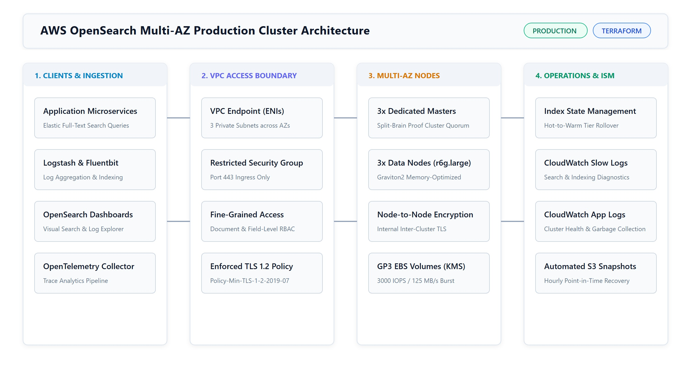

# :rocket: Terraform AWS OpenSearch Multi-AZ Production Cluster

<p align="center">
  
</p>

<div align="center">

[]()
[]()
[](LICENSE)
[](https://github.com/tayyabmasood911/terraform-aws-opensearch-cluster/pulls)
[]()

</div>

---

## :memo: Executive Summary

**Terraform AWS OpenSearch Cluster** is an enterprise-grade Infrastructure-as-Code (IaC) repository that automates the deployment of a hardened, Multi-AZ Amazon OpenSearch Service cluster (OpenSearch 2.11). Architected for mission-critical search queries, log indexing, and distributed trace analytics, this blueprint incorporates 3-AZ zone awareness, 3 dedicated Graviton2 master nodes, fine-grained access control (FGAC), node-to-node encryption, and automated CloudWatch slow query logging.

Key operational outcomes:
- **Resilience:** 3-AZ zone awareness with 3 dedicated master nodes eliminates split-brain split quorum scenarios and tolerates full Availability Zone outages.
- **Performance:** Graviton2 `r6g.large.search` memory-optimized data nodes backed by high-throughput `gp3` storage (3,000 baseline IOPS, 125 MB/s throughput).
- **Zero-Trust Security:** Mandatory HTTPS with TLS 1.2+ cipher policy, internal node-to-node TLS encryption, KMS envelope encryption at rest, and VPC subnet boundary enforcement.
- **Deep Observability:** Dedicated CloudWatch log streams capturing Indexing Slow Logs, Search Slow Logs, and Elasticsearch Application crash logs.

---

## :building_construction: System Architecture

```text
+---------------------------------------------------------------------------------------------------+
|                         AWS OpenSearch Multi-AZ Architecture Blueprint                            |
|                                                                                                   |
|   +--------------------------+         +------------------------------------------------------+   |
|   | Clients & Ingestion      | ======> | VPC Network Boundary (Port 443 HTTPS Only)           |   |
|   | - Application Search API |  TLS1.2 | - Elastic Network Interfaces (ENIs) across 3 Subnets |   |
|   | - Logstash / Fluentbit   |         | - Restricted Security Group (10.0.0.0/16)            |   |
|   | - OpenTelemetry Pipeline |         | - Fine-Grained Access Control (FGAC / IAM)           |   |
|   +--------------------------+         +------------------------------------------------------+   |
|                                                                   |                               |
|                                                                   v                               |
|                                        +------------------------------------------------------+   |
|                                        | Amazon OpenSearch Multi-AZ Cluster (OpenSearch 2.11) |   |
|                                        |                                                      |   |
|                                        |   +----------------------------------------------+   |   |
|                                        |   | 3x Dedicated Master Nodes (c6g.large.search) |   |   |
|                                        |   | Quorum Election & Cluster State Coordination |   |   |
|                                        |   +----------------------------------------------+   |   |
|                                        |                                                      |   |
|                                        |   +----------------------------------------------+   |   |
|                                        |   | 3x Data Nodes across 3 AZs (r6g.large.search)|   |   |
|                                        |   | - GP3 EBS Storage (KMS Encrypted at Rest)    |   |   |
|                                        |   | - Node-to-Node Inter-Cluster TLS Encryption  |   |   |
|                                        |   +----------------------------------------------+   |   |
|                                        +------------------------------------------------------+   |
|                                                                   |                               |
|                                                                   v                               |
|                                        +------------------------------------------------------+   |
|                                        | Observability & Lifecycle Management                 |   |
|                                        | - CloudWatch Index & Search Slow Logs (30d retention)|   |
|                                        | - ES Application Error & Health Logs                 |   |
|                                        | - Index State Management (Hot-Warm Tier Rollover)    |   |
|                                        | - Automated Daily S3 Cluster Snapshots               |   |
|                                        +------------------------------------------------------+   |
+---------------------------------------------------------------------------------------------------+
```

---

## :sparkles: Key Enterprise Capabilities

- :zap: **3-AZ High Availability:** Balances primary and replica shards across three separate Availability Zones, ensuring zero data loss during regional hardware disruptions.
- :shield: **Fine-Grained Access Control (FGAC):** Enforces document-level and field-level security, enabling multi-tenant data isolation within a shared cluster.
- :lock: **Comprehensive Encryption:** Secures every layer of data lifecycle: TLS 1.2+ in transit, mutual TLS between internal cluster nodes, and KMS customer keys at rest.
- :chart_with_upwards_trend: **Cost-Effective Scalability:** Integrates dedicated Graviton2 ARM-based compute nodes offering up to 40% better price-performance over legacy x86 instances.
- :mag: **Diagnostic Query Profiling:** CloudWatch slow log capture immediately isolates inefficient regex queries and heavy aggregations degrading search responsiveness.

---

## :file_folder: Repository Directory Structure

```text
.
|-- .github/             # Automated CI workflows for Terraform linting and validation
|-- config/              # Example environment variable templates
|-- docs/
|   `-- images/          # White-theme architectural blueprints and vector diagrams
|       |-- architecture.svg
|       `-- architecture-white.jpg
|-- scripts/             # Operational validation and health check tooling
|-- tests/               # Python-based syntax and policy validation tests
|-- .gitattributes       # Linguist configuration ensuring accurate language detection
|-- LICENSE              # MIT Open Source License
|-- main.tf              # OpenSearch cluster domain, encryption, and cluster topology
|-- Makefile             # Operational targets for formatting, linting, and testing
|-- outputs.tf           # Exported domain endpoints, ARNs, and dashboard URLs
|-- README.md            # Enterprise architectural documentation
|-- SECURITY.md          # Vulnerability disclosure and security policy
|-- variables.tf         # Parameterized configuration inputs and thresholds
`-- vpc_options.tf       # Security group, VPC endpoint configuration, and CloudWatch log groups
```

---

## :zap: Quick Start & Deployment

### Prerequisites
- Terraform `>= 1.5.0`
- AWS CLI configured with OpenSearch, VPC, and IAM administrative permissions
- Existing VPC with private subnets across 3 Availability Zones

### Deployment Steps
```bash
# 1. Clone the repository
git clone https://github.com/tayyabmasood911/terraform-aws-opensearch-cluster.git
cd terraform-aws-opensearch-cluster

# 2. Inspect and configure input variables
cp config/production.env.example .env

# 3. Initialize Terraform and validate configuration
terraform init
terraform fmt -check
terraform validate

# 4. Generate deployment execution plan
terraform plan \
  -var="vpc_id=vpc-0123456789abcdef0" \
  -var="subnet_ids=[\"subnet-01\",\"subnet-02\",\"subnet-03\"]" \
  -var="domain_name=prod-search-cluster" \
  -out=tfplan

# 5. Apply infrastructure changes
terraform apply tfplan
```

---

## :gear: Configuration Reference

| Parameter | Type | Default | Description |
| :--- | :--- | :--- | :--- |
| `domain_name` | string | `prod-search-cluster` | Unique name of the OpenSearch cluster domain |
| `engine_version` | string | `OpenSearch_2.11` | OpenSearch engine version to provision |
| `instance_type` | string | `r6g.large.search` | Compute instance type for active data nodes |
| `instance_count` | number | `3` | Total number of data nodes provisioned across AZs |
| `zone_awareness_enabled` | bool | `true` | Enables Multi-AZ zone awareness routing |
| `availability_zone_count` | number | `3` | Number of Availability Zones (2 or 3) |
| `dedicated_master_enabled`| bool | `true` | Deploys dedicated master nodes for cluster quorum |
| `dedicated_master_type` | string | `c6g.large.search` | Compute instance type for dedicated master nodes |
| `ebs_volume_size` | number | `100` | Storage size in GiB per node (GP3) |
| `ebs_iops` | number | `3000` | Baseline provisioned IOPS for GP3 storage |
| `ebs_throughput` | number | `125` | Baseline provisioned throughput in MB/s |

---

## :lock: Security, Compliance & Governance

1. **Strict VPC Placement:** The cluster is unreachable from the public Internet and resides exclusively on private subnets.
2. **Encrypted Transport:** Enforces `Policy-Min-TLS-1-2-2019-07` and blocks plain HTTP requests.
3. **Internal Node Encryption:** Inter-node communication is protected with mutual cryptographic TLS handshakes.
4. **Data at Rest Protection:** Storage partitions are encrypted at rest with AES-256 KMS keys.

---

## :bust_in_silhouette: Author & Maintainer

**Tayyab Masood**  
Cloud Solutions Architect & Senior DevOps Engineer  
- :globe_with_meridians: **GitHub:** [@tayyabmasood911](https://github.com/tayyabmasood911)  
- :scroll: **Certification:** AWS Certified Solutions Architect - Associate  

---

## :page_facing_up: License

This project is licensed under the **MIT License** - see the [LICENSE](LICENSE) file for details.
